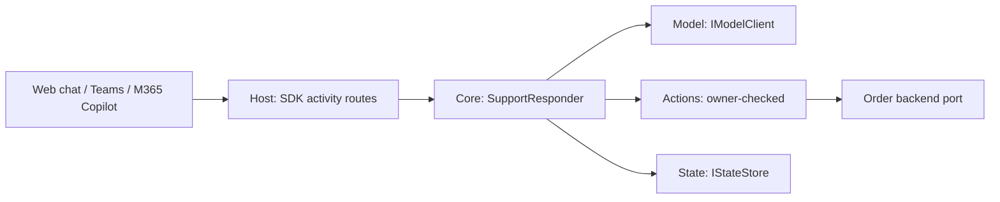

# lesson-dotnet-agent-host

**Question this repo answers:** what does a first .NET agent need besides the model?

**After reading it you can:** stand up a [Microsoft 365 Agents SDK](https://learn.microsoft.com/en-us/microsoft-365/agents-sdk/) host with one shared conversation flow, keep business actions narrow and owner-checked, choose where state lives, and test all of it without a model, a network or a secret.

Companion code for the article *Build Your First .NET Agent Without Hiding the Hard Parts* ([read it on Medium](https://medium.com/@benceroth/build-your-first-ai-agent-in-net-with-surprisingly-little-code-630952ad1691)). The scenario is fictional: Northstar Outfitters, an order-support assistant.

> The "AI" here is a deterministic, rule-based fake (`FakeModelClient`). That is deliberate: the sample proves the host, routing, actions, state and error paths. It is not an intelligent assistant.

## Run it (no model key, no cloud)

Requirements: .NET SDK 10 (`global.json` pins 10.0.100 with roll-forward).

```powershell
dotnet build
dotnet test
dotnet run --project src/Northstar.Agent.Host     # listens on http://localhost:3978
```

Then talk to it. Two ways:

1. **Without installing anything** (another terminal): `./scripts/smoke.ps1` posts activities to `/api/messages` and prints the replies.
2. **With Microsoft's Agents Playground** (follows the [official quickstart](https://learn.microsoft.com/en-us/microsoft-365/agents-sdk/quickstart?pivots=dotnet)):
   ```powershell
   npm install -g @microsoft/teams-app-test-tool
   teamsapptester
   ```
   Try: `Where is order NS-1042?`, `What about NS-1043?`, `Can I return it?`, `Where is NS-2001?` (someone else's order), `Show my recent orders`.

In `Development` the host maps every channel user to the demo customer `cust-alice` (`appsettings.Development.json`). Outside Development it refuses to start (see Known limits).

## What is in here

| Project | Job | Knows the SDK? |
|---|---|---|
| `Northstar.Agent.Host` | ASP.NET Core host, SDK wiring, activity routes, caller mapping | **yes (only this one)** |
| `Northstar.Agent.Core` | One conversation flow: interpret, act, remember, reply; error policy | no |
| `Northstar.Agent.Actions` | Narrow, typed, owner-checked actions over a read-only order port | no |
| `Northstar.Agent.Orders.Fake` | In-memory orders and fixtures | no |
| `Northstar.Agent.Model` | `IModelClient` plus the rule-based `FakeModelClient` | no |
| `Northstar.Agent.State` | `IStateStore`: in-memory and SQLite | no |

A test (`ArchitectureTests`) fails if any project other than Host references `Microsoft.Agents.*`.



## Build it in stages

History is four commits, tagged so you can check out or browse each stage.

| Tag | What it adds | Try it |
|---|---|---|
| [`stage-1`](https://github.com/benceroth/lesson-dotnet-agent-host/tree/stage-1) | ASP.NET Core host, SDK package, welcome + echo handlers, `/api/messages` | `dotnet run --project src/Northstar.Agent.Host`, then `./scripts/smoke.ps1` |
| [`stage-2`](https://github.com/benceroth/lesson-dotnet-agent-host/tree/stage-2) | `ISupportResponder`, fake model, narrow owner-checked actions, in-memory state, host tests | `dotnet test` |
| [`stage-3`](https://github.com/benceroth/lesson-dotnet-agent-host/tree/stage-3) | Persistent state (SQLite) and the restart tests | `dotnet test --filter StateStoreTests` |
| [`stage-4`](https://github.com/benceroth/lesson-dotnet-agent-host/tree/stage-4) | Scripted model, sample transcript, `break-it/` failures, docs | `dotnet run --project break-it` |

```powershell
git checkout stage-1
```

## See one run, then break it

- [`samples/transcript.txt`](samples/transcript.txt): one offline run (scripted model) with a trace at the parser, tool and state boundaries. Regenerate with `dotnet run --project samples/Transcript -- samples/transcript.txt`.
- [`break-it/`](break-it/README.md): four deliberate failures (malformed model output, out-of-range argument, state lost on restart, hung model), each with expected behaviour and the fix. Run `dotnet run --project break-it`.
- Swap the model: `tests/Core.Tests/ModelSwapTests.cs` runs the same conversations against two model implementations; `HostFlowTests.Swapping_the_model_provider_leaves_the_host_flow_unchanged` does it through the real SDK pipeline.

## Extend it

1. **Add a tool.** Add `get_tracking_events(orderId)` to `OrderActions`: validate, check ownership, return a limited view. Write the ownership test first.
2. **Write a real model client.** Implement `IModelClient` on top of your provider of choice. It must only return an `Intent`. Re-run `dotnet test` and `dotnet run --project break-it` unchanged.
3. **Add a break-it case.** Make the order backend return an order whose `CustomerId` is someone else's from `ListOrdersForCustomerAsync` and check the reply never lists it.
## Claims, and where they are proven

| Claim from the post | Proof |
|---|---|
| Test order lookup without a model | `tests/Core.Tests/ConversationTests.cs` |
| Narrow action; model suggests, code authorizes | `tests/Actions.Tests/OrderActionsTests.cs` (`GetOrderStatus_refuses_an_order_owned_by_someone_else`) |
| In-memory state is lost on restart; persistent state is not | `tests/Core.Tests/StateStoreTests.cs` |
| Define failure behavior (timeouts, backend, storage) | `tests/Core.Tests/ErrorHandlingTests.cs`, `tests/Host.Tests/HostFlowTests.cs` |
| Log decisions, not content | `ErrorHandlingTests.Logs_record_the_decision_but_not_the_message_text` |
| Activity in, activity out through the real SDK pipeline | `tests/Host.Tests/HostFlowTests.cs` |
| The model can be swapped without touching host tests | `tests/Core.Tests/ModelSwapTests.cs` |
| Bad model output and bad arguments never reach the order service | `break-it/` |

More: [architecture](docs/architecture.md), [channel setup](docs/channel-setup.md), [state choices](docs/state-choices.md), [mistakes that survive the demo](docs/mistakes-that-survive-the-demo.md), [next iteration](docs/next-iteration.md).

## Versions tested

- Microsoft 365 Agents SDK for .NET: `Microsoft.Agents.Hosting.AspNetCore` **1.9.205** (latest stable on NuGet when this was written; the post tells you to re-check). Package name and the host wiring (`AddAgentApplicationOptions`, `AddAgent<T>`, `IAgentHttpAdapter.ProcessAsync`) follow the official quickstart.
- .NET SDK 10.0.201, target `net10.0`.
- Verified by running `dotnet build`, `dotnet test` and the host itself (`scripts/smoke.ps1`) on Windows. CI runs build, test and format check on Ubuntu.

## Configuration and secrets

`appsettings.example.json` has placeholders only (shape taken from the SDK's own samples). Use [user secrets](https://learn.microsoft.com/aspnet/core/security/app-secrets) or environment variables for real values; never commit them. The default path needs none.

State provider: `State:Provider` = `InMemory` (default) or `Sqlite` (`State:SqlitePath`).

## Known limits

- **No production authentication.** The host starts only if `Host:AllowAnonymous` is `true`; token validation/Entra wiring is not implemented here. `docs/channel-setup.md` lists what is needed.
- **Teams and Microsoft 365 Copilot were not tested.** Only the HTTP activity path (tests, `smoke.ps1`) was exercised. The Playground path follows the official quickstart but was not run for this repo's write-up.
- **No real model.** `IModelClient` is the swap point; no Azure OpenAI or Semantic Kernel implementation is included (see next-iteration).
- Identity mapping is a configuration table, not real account linking.
- SQLite is single-node. Cosmos DB / Blob storage are documented, not implemented.
- The post's "illustrative implementation comparison" is not measured here: no hand-built second channel path exists.

## License

MIT. See [LICENSE](LICENSE), [SECURITY.md](SECURITY.md), [CONTRIBUTING.md](CONTRIBUTING.md).

<sub>[Bence Roth](https://broth.hu/)</sub>
