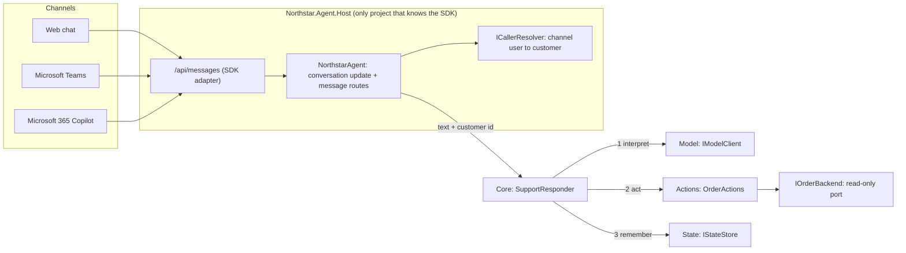

# Architecture

## One turn

1. The SDK adapter turns the HTTP request into an activity and calls the route registered in `NorthstarAgent`.
2. The handler resolves the **customer** from the authenticated channel identity (never from message text) and calls `ISupportResponder`.
3. `SupportResponder` reads conversation state, asks `IModelClient` for an `Intent` (a kind plus an untrusted order-id string), and dispatches to one narrow action.
4. The action validates the id, loads the order, checks `order.CustomerId == caller.CustomerId`, and returns a limited projection.
5. State is updated with the last order the customer *legitimately* asked about. Order status is never stored.
6. The reply goes back through the same handler. Timeouts, backend and model errors become fixed safe messages; details go to logs.

## Boundaries and why

- **Model returns an intent, not an action.** Even a real model can only say what it thinks the user wants. Deterministic code decides what is allowed.
- **Actions depend on a read-only port.** The backend interface has no write methods; a test asserts that.
- **Core has no SDK types.** That is what lets the whole conversation flow run in plain unit tests. `ArchitectureTests` enforces it.
- **Two kinds of state.** The SDK's `IStorage` (turn state, registered as `MemoryStorage`) and our `IStateStore` (conversation facts). The sample uses SDK storage only because the SDK requires it. See [state-choices](state-choices.md).
